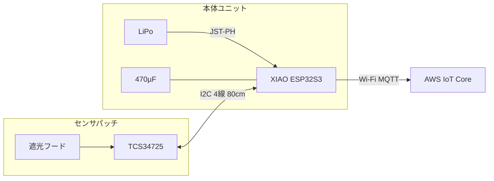

# 配線図（Wi-Fi 第1弾）

Issue #11。試作1台の実装配線。部品リストは [bom.md](bom.md) を参照。

**単線図・複線図・回路図**: [schematic.md](schematic.md)  
本文は組み立て手順・実物確認向けの補足。

- **対象**: XIAO ESP32S3 + TCS34725 + LiPo（Wi-Fi のみ）
- **対象外**: LTE-M モジュール、防水ケース内レイアウト（#12）

---

## 1. システム構成

```
[満空灯発光面]
      │ 光
      ▼
[遮光フード + TCS34725]  ← センサパッチ（取り外し可）
      │ I2C 延長ケーブル（4P・80cm）
      ▼
[Seeed XIAO ESP32S3]  ← 本体ユニット
      │ Wi-Fi（内蔵アンテナ）/ MQTT
      ▼
[AWS IoT Core] → [Lambda ブリッジ] → FIWARE Orion

[LiPo 3.7V] ──JST-PH──→ [XIAO BAT パッド]
```



---

## 2. XIAO ESP32S3 ピンアサイン

USB コネクタを上にして、ピンヘッダーが手前にある向きで記載する。

### 2.1 本 PoC で使用するピン

| XIAO ピン | ESP32 GPIO | 用途 | 接続先 |
|---|---|---|---|
| 3V3 | — | 電源出力 | TCS34725 VCC、470µF + 側 |
| GND | — | グランド | TCS34725 GND、470µF − 側 |
| D4 | GPIO5 | I2C SDA | TCS34725 SDA |
| D5 | GPIO6 | I2C SCL | TCS34725 SCL |
| BAT+ | — | LiPo + | JST-PH メス（赤） |
| BAT− | — | LiPo − | JST-PH メス（黒） |

### 2.2 未使用ピン（第1弾）

| ピン | 備考 |
|---|---|
| 5V | Wi-Fi 第1弾では未使用。LTE-M 追加時に要確認（#12） |
| D6 / D7 | UART（LTE-M 用・将来） |
| D0〜D3, D8〜D12 | 未使用 |

### 2.3 はんだ付け位置（2か所）

XIAO はピンヘッダー非同梱。**はんだ付けする場所は用途で2か所**ある（混同しやすいので分けて記載）。

#### A. ピンヘッダー（ジャンパ線・延長ケーブル用）

1×40 ピンヘッダーから **14ピン分** を切り出し、基板**長辺の穴付きパッド列**にはんだ付ける。表からピンを刺し、**裏で半田**するのが一般的。

```
        USB-C（この端が上）
  ┌─●─●─●─●─●─●─●─┐  ← 長辺のパッド列（ここにピンヘッダー）
  │   XIAO 表（部品面） │
  └─●─●─●─●─●─●─●─┘
        長辺のパッド列
```

使用するのは 3V3, GND, D4, D5 など計14ピン分（両長辺にまたがる）。

#### B. LiPo 用 JST（BAT パッド）

基板**裏面**にシルクで `BAT+` / `BAT−` と印字された **2つの金属パッド** に、JST-PH メスコネクタ（またはリード線）をはんだ付ける。

```
  裏面を上にして USB を手前にしたとき:

  ┌─────────────────────────┐
  │                         │
  │   BAT+        BAT−      │  ← 裏面の2パッド
  │   （＋）       （−）      │
  │              ↑ USB に近い方が BAT−
  │                         │
  │   [Thermal PAD]         │  ← 放熱用（今回は未使用）
  └─────────────────────────┘
        USB 側（手前）
```

極性（[Seeed 公式](https://wiki.seeedstudio.com/xiao_esp32s3_getting_started/)）:
- **BAT−** … USB コネクタに**近い**パッド
- **BAT+** … USB コネクタから**遠い**パッド

---

## 3. TCS34725 I2C 接続

### 3.1 センサ仕様

| 項目 | 値 |
|---|---|
| インターフェース | I2C |
| I2C アドレス | `0x29` |
| 動作電圧 | 2.7〜3.6 V |
| 白色 LED | **未接続**（表示灯の光のみ読む） |

**5V ピンに接続しないこと。** XIAO の **3V3** のみ使用する。

### 3.2 延長ケーブル（4P デュポン・80cm）

[bom.md](bom.md) のピン割り当てに従う。ケーブル両端は **4P メス** コネクタ。

| 4P # | 信号 | 線色（推奨） | XIAO 側 | センサ側 |
|---|---|---|---|---|
| 1 | 3V3 | 赤 | 3V3 | VCC / VIN / 3V3 |
| 2 | GND | 黒 | GND | GND |
| 3 | SDA | 黄 | D4 | SDA |
| 4 | SCL | 緑 | D5 | SCL |

```
[XIAO ピンヘッダ]              [延長ケーブル 80cm]           [センサパッチ]
 3V3 ─────┐                      ┌── 4Pメス ───────── 4Pメス ──┐  1×4オス
 GND ─────┤  4Pメス（差込）  ═══  ┘                              ├── VCC
 D4  ─────┤                                                      ├── GND
 D5  ─────┘                                                      ├── SDA
                                                                  └── SCL
                                                                       │
                                                                  [TCS34725]
```

- **脱着点**: センサ側の 4P メス ↔ センサパッチの 1×4 オス
- コネクタを差した状態で、ピン1が 3V3 に対応していることをテスターで確認する

### 3.3 TCS34725 モジュールのピン並び

ストロベリーリナックス #13472 の基板には **オス・メス両方のピンヘッダ** が付属する。延長ケーブルは **メス側ピン** に差し込む。

モジュールのピンラベルは実物のシルク印刷で確認すること。一般的な TCS34725 ブレークアウトの信号は次のとおり。

| 信号 | 接続 |
|---|---|
| VCC / VIN / 3V3 | 延長ケーブル ピン1（3V3） |
| GND | 延長ケーブル ピン2（GND） |
| SDA | 延長ケーブル ピン3（SDA） |
| SCL | 延長ケーブル ピン4（SCL） |
| LED / LEDK / LEDA | **未接続** |
| INT | **未接続** |

センサパッチ用に **1×4 オスピンヘッダ** をモジュール端にはんだ付けし、上表の順序に合わせて配線する。基板のピン順と延長ケーブルの 1〜4 が一致するよう、はんだ前にメモしておく。

---

## 4. 電源配線

### 4.1 LiPo → XIAO

```
[LiPo 4,400mAh]          [XIAO 裏面]
  JST-PH オス ────────→  JST-PH メス（はんだ付け）
                         ├→ BAT+
                         └→ BAT−
```

| 項目 | 内容 |
|---|---|
| コネクタ | JST-PH 2.0（2pin） |
| 極性 | **接続前にテスターで確認**。BAT− は USB ポートに近い側 |
| 充電 | USB-C 接続で XIAO 内蔵チャージャー経由で LiPo を充電 |
| 注意 | LiPo を BAT に直結。5V ピンや VBUS への直結はしない |

### 4.2 470µF コンデンサ

Wi-Fi 送信時の電流スパイクによる電圧降下を抑える。XIAO の **3V3** と **GND** の間にできるだけ近接して接続する。

```
  3V3 ────┬──── （TCS34725 等へ）
          │
        ┌─┴─┐
        │470│ µF  （− マークの脚 → GND）
        │ µF│
        └─┬─┘
          │
  GND ────┴────
```

| 脚 | 接続先 |
|---|---|
| +（長脚） | 3V3 |
| −（短脚、ストライプ側） | GND |

はんだ付けが難しい初期デバッグ時は、ジャンパ線（オス-メス）で仮接続してもよい。

---

## 5. 接続一覧（全体）

| 起点 | 終点 | 線種 | 備考 |
|---|---|---|---|
| LiPo + | XIAO BAT+ | JST-PH 2pin | 極性確認必須 |
| LiPo − | XIAO BAT− | JST-PH 2pin | 同上 |
| XIAO 3V3 | TCS34725 VCC | 延長ケーブル ピン1 | 2.54mm 4P |
| XIAO GND | TCS34725 GND | 延長ケーブル ピン2 | 同上 |
| XIAO D4 | TCS34725 SDA | 延長ケーブル ピン3 | 同上 |
| XIAO D5 | TCS34725 SCL | 延長ケーブル ピン4 | 同上 |
| XIAO 3V3 | 470µF + | 短い線 or 直接はんだ | XIAO 近傍 |
| XIAO GND | 470µF − | 短い線 or 直接はんだ | XIAO 近傍 |

I2C バスに追加デバイスはない。プルアップ抵抗は TCS34725 モジュール基板側に実装済み（0.1µF バイパスも同梱）。

---

## 6. 組み立て順序

[bom.md](bom.md) のチェックリストに対応。

1. **棚卸し**: Raspberry Pi センサーキットがあれば重複部品を確認
2. **XIAO**: ピンヘッダー 14ピン分をはんだ → 裏面 BAT パッドに JST-PH メスをはんだ（極性確認）
3. **電源確認**: LiPo を接続し、USB 非接続で XIAO が起動するか確認
4. **センサパッチ**: TCS34725 に 1×4 オスピンヘッダをはんだ → 遮光フードを取り付け（#3）
5. **延長ケーブル**: 80cm・4P メス両端を作成 → 導通・ピン順をテスターで確認
6. **470µF**: 3V3-GND 間に接続
7. **結線**: 延長ケーブルで XIAO ↔ センサパッチを接続
8. **動作確認**: USB 接続でシリアル出力・I2C スキャン（#5）

---

## 7. 動作確認のヒント

### I2C スキャン

アドレス `0x29` が見えれば配線成功の目安。

### よくあるミス

| 症状 | 確認点 |
|---|---|
| I2C デバイスが見えない | SDA/SCL の取り違え、3V3/GND 逆、ケーブル 4P のピン順 |
| 値が不安定 | GND 共通が取れていない、延長ケーブルが長すぎる／接触不良 |
| XIAO が起動しない | LiPo JST 極性逆、BAT はんだの虚焊 |
| センサが飽和・異常 | 5V を VCC に入れていないか確認 |

---

## 8. 将来拡張（参考・未配線）

LTE-M 第2弾で追加予定の接続。今回は配線しない。

| 信号 | XIAO | 接続先 |
|---|---|---|
| TX | D6 (GPIO43) | SIM7080G RX |
| RX | D7 (GPIO44) | SIM7080G TX |
| GND | GND | SIM7080G GND |
| 5V | 5V | SIM7080G 5V（LiPo 単体時の有効性は #12 で確認） |

詳細は [hardware.md](hardware.md) の通信セクションを参照。
