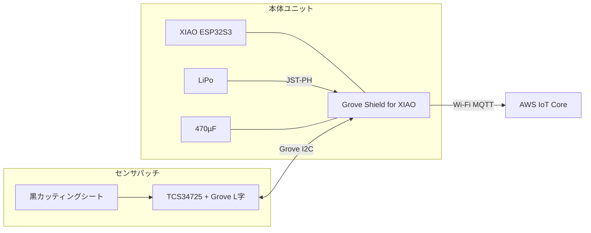

# 配線図（Wi-Fi 第1弾）

Issue #11。試作1台の実装配線。部品リストは [bom.md](bom.md) を参照。

**単線図・複線図・回路図**: [schematic.md](schematic.md)  
本文は組み立て手順・実物確認向けの補足。

- **対象**: XIAO ESP32S3 + Grove Shield + TCS34725 + LiPo（Wi-Fi のみ）
- **対象外**: LTE-M モジュール、防水ケース内レイアウト（#14）

---

## 1. システム構成

```
[満空灯発光面]
      │ 光
      ▼
[黒シート + TCS34725 + Grove L字]  ← センサパッチ（テープ固定・取り外し可）
      │ Grove 4芯ケーブル（50〜100cm）
      ▼
[XIAO ESP32S3 + Grove Shield]  ← 本体ユニット
      │ Wi-Fi（内蔵アンテナ）/ MQTT
      ▼
[AWS IoT Core] → [Lambda ブリッジ] → FIWARE Orion

[LiPo 3.7V] ──JST-PH──→ [Grove Shield BAT パッド]
```



---

## 2. XIAO + Grove Shield

### 2.1 スタック構成

1. XIAO ESP32S3 に 1×40 ピンヘッダー（14ピン分）をはんだ付け
2. Grove Shield for XIAO を XIAO に装着（全ピンを通す）
3. センサ・電源・コンデンサは **Shield 上の Grove ポート / BAT パッド**を使用する

### 2.2 本 PoC で使用する接続

| 接続先 | 用途 | 備考 |
|---|---|---|
| Grove I2C ポート（いずれか1つ） | TCS34725 | 標準 Grove ピン配置のまま |
| BAT+ / BAT− パッド | LiPo | JST-PH メスをはんだ付け |
| 3V3 / GND（Shield 上のパッドまたはピン） | 470µF | Wi-Fi 時の電圧降下対策 |

I2C は Shield 経由で XIAO の **D4（GPIO5 / SDA）**・**D5（GPIO6 / SCL）** にルーティングされる（ファームウェアの `board_xiao.h` と一致）。

### 2.3 未使用（第1弾）

| 接続 | 備考 |
|---|---|
| Grove UART ポート | LTE-M（M5STACK-U128）導入時に使用 |
| その他 Grove ポート | 未使用 |

### 2.4 はんだ付け位置

#### A. XIAO ピンヘッダー（Shield 装着用）

1×40 ピンヘッダーから **14ピン分** を切り出し、XIAO 長辺のパッド列にはんだ付ける。表からピンを刺し、裏で半田する。

```
        USB-C（この端が上）
  ┌─●─●─●─●─●─●─●─┐  ← 長辺のパッド列（ここにピンヘッダー）
  │   XIAO 表（部品面） │
  └─●─●─●─●─●─●─●─┘
```

#### B. LiPo 用 JST（Grove Shield BAT パッド）

**Grove Shield 基板**上の `BAT+` / `BAT−` パッドに、JST-PH 2.0mm **メス**コネクタ（またはリード線）をはんだ付けする。

- XIAO 本体には JST コネクタは**搭載されていない**（BAT パッドのみ）。電源接続は Shield 側で行う。
- **はんだ付け前にテスターで極性（＋−）を必ず確認**する。
- LiPo（手元: 4,400mAh・JST PH 2.0mm オス）を抜き差し可能にする。

極性の目安（Shield シルク・[Seeed Wiki](https://wiki.seeedstudio.com/Grove-Shield-for-Seeeduino-XIAO-embedded-battery-management-chip/) を実物で確認）:
- **BAT+** … LiPo の赤（＋）
- **BAT−** … LiPo の黒（−）

---

## 3. TCS34725 Grove 接続

### 3.1 センサ仕様

| 項目 | 値 |
|---|---|
| インターフェース | I2C |
| I2C アドレス | `0x29` |
| 動作電圧 | 2.7〜3.6 V |
| 白色 LED | **未接続**（表示灯の光のみ読む） |

**5V に接続しないこと。** Grove I2C ポートの 3.3V 系統のみ使用する。

### 3.2 Grove L字コネクタのはんだ付け

TCS34725 基板（ストロベリーリナックス #13472）に **Grove L字コネクタ**（2mm ピッチ 4ピン）をはんだ付けする。基板の GND / SDA / SCL / VDD パッドに合わせて向きを決める。

### 3.3 ケーブルピン入替（TCS34725 側のみ）

Grove 4芯ケーブルは **Shield 側は標準のまま**、**TCS34725 側のコネクタのみ**ピンを入替える。

コネクタハウジングのラッチを押し、ピンを抜いて正しいスロットに差し直す（工具不要・ハンダ不要）。

| Grove ケーブル標準 | 線色 | 信号 | TCS34725 基板ピン |
|---|---|---|---|
| ピン1 | 黄 | SCL | 3: SCL |
| ピン2 | 白 | SDA | 2: SDA |
| ピン3 | 赤 | VCC | 4: VDD |
| ピン4 | 黒 | GND | 1: GND |

```
[Grove Shield I2C]     [Grove 4芯ケーブル]        [TCS34725 側]
  標準ピン配置    ═══════════════════════   ピン入替後コネクタ
  黄 SCL ─────────────────────────────────→ ピン3 SCL
  白 SDA ─────────────────────────────────→ ピン2 SDA
  赤 VCC ─────────────────────────────────→ ピン4 VDD
  黒 GND ─────────────────────────────────→ ピン1 GND
```

入替後、テスターで各ピンの導通を確認する（Shield 側 Grove ポートの SCL/SDA/VCC/GND と TCS34725 各パッド）。

### 3.4 TCS34725 モジュールのピン並び（参考）

ストロベリーリナックス #13472 の基板ピン順（シルクで要確認）:

| 物理ピン | 信号 |
|---|---|
| 1 | GND |
| 2 | SDA |
| 3 | SCL |
| 4 | VDD |
| LED / INT | **未接続** |

---

## 4. 電源配線

### 4.1 LiPo → Grove Shield

```
[LiPo 4,400mAh]          [Grove Shield]
  JST-PH オス ────────→  JST-PH メス（はんだ付け）
                         ├→ BAT+
                         └→ BAT−
                              │
                         [XIAO へ給電・充電管理]
```

| 項目 | 内容 |
|---|---|
| コネクタ | JST-PH 2.0（2pin） |
| 極性 | **接続前にテスターで確認** |
| 充電 | USB-C 接続で Shield 経由の充電管理で LiPo を充電 |
| 注意 | LiPo を BAT パッドに直結。5V ピンや VBUS への直結はしない |

### 4.2 470µF コンデンサ

Wi-Fi 送信時の電流スパイクによる電圧降下を抑える。Grove Shield 上の **3V3** と **GND** の間にできるだけ近接して接続する。

```
  3V3 ────┬──── （Shield / XIAO 系統）
          │
        ┌─┴─┐
        │470│ µF  （− マークの脚 → GND）
        │ µF│
        └─┬─┘
          │
  GND ────┴────
```

はんだ付けが難しい初期デバッグ時は、ジャンパ線（オス-メス）で仮接続してもよい。

---

## 5. 接続一覧（全体）

| 起点 | 終点 | 線種 | 備考 |
|---|---|---|---|
| LiPo + | Grove Shield BAT+ | JST-PH 2pin | 極性確認必須 |
| LiPo − | Grove Shield BAT− | JST-PH 2pin | 同上 |
| Grove Shield I2C | TCS34725（Grove L字） | Grove 4芯ケーブル | TCS 側ピン入替済み |
| Shield 3V3 | 470µF + | 短い線 or 直接はんだ | Shield 近傍 |
| Shield GND | 470µF − | 短い線 or 直接はんだ | Shield 近傍 |

I2C バスに追加デバイスはない。プルアップ抵抗は TCS34725 モジュール基板側に実装済み。

---

## 6. センサパッチの機構（参考）

現場設置時の固定方法。電気配線とは別だが組み立て時に合わせて実施する。

1. 黒カッティングシートに受光窓を切り抜く（推奨位置: LED 配列の **下から2行目・左から2列目** 付近）
2. TCS34725 の受光部を窓に合わせてシートに貼付
3. 透明テープで発光面（透明アクリル）全体に固定（落下防止）

詳細は README §3.3・[hardware.md](hardware.md) を参照。

---

## 7. 組み立て順序

[bom.md](bom.md) のチェックリストに対応。

1. **棚卸し**: Raspberry Pi センサーキットがあれば重複部品を確認
2. **XIAO**: ピンヘッダー 14ピン分をはんだ → Grove Shield に装着
3. **電源**: Shield BAT パッドに JST-PH メスをはんだ（極性確認）→ LiPo 接続・起動確認
4. **センサパッチ**: TCS34725 に Grove L字をはんだ → 黒シートに受光窓を切って貼付
5. **Grove ケーブル**: TCS34725 側ピンを入替え → 導通確認
6. **470µF**: Shield 3V3-GND 間に接続
7. **結線**: Grove ケーブルで Shield I2C ↔ センサパッチを接続
8. **動作確認**: USB 接続でシリアル出力・I2C スキャン（#5）

---

## 8. 動作確認のヒント

### I2C スキャン

アドレス `0x29` が見えれば配線成功の目安。

### よくあるミス

| 症状 | 確認点 |
|---|---|
| I2C デバイスが見えない | TCS34725 側のピン入替ミス、SDA/SCL 取り違え、VCC/GND 逆 |
| 値が不安定 | GND 共通が取れていない、Grove ケーブル接触不良 |
| 起動しない | LiPo JST 極性逆、Shield BAT はんだの虚焊 |
| センサが飽和・異常 | 5V を VCC に入れていないか確認 |

---

## 9. 将来拡張（参考・未配線）

LTE-M 導入時は **M5Stack SIM7080G CAT-M Unit（M5STACK-U128）** を Grove Shield の **UART ポート**にケーブル1本で接続する。PoC 第1弾では配線しない。

| 項目 | 内容 |
|---|---|
| モジュール | M5STACK-U128（Grove UART・SIM7080G） |
| SIM | SORACOM plan-D / plan-KM1（動作確認済み） |
| 判断 | Wi-Fi が使えない現場が出た時点で追加購入 |

詳細は [hardware.md](hardware.md) の通信セクションを参照。
